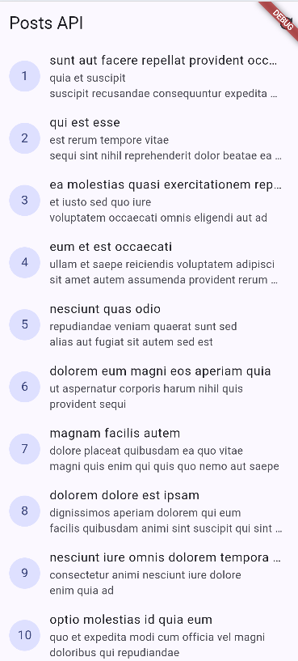
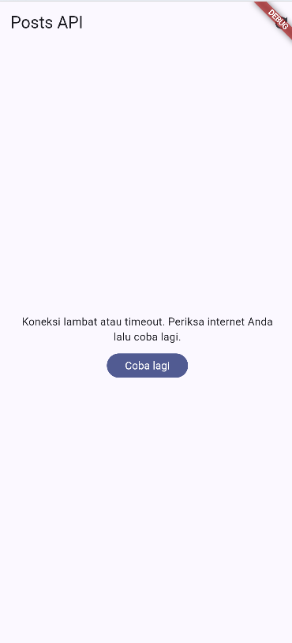
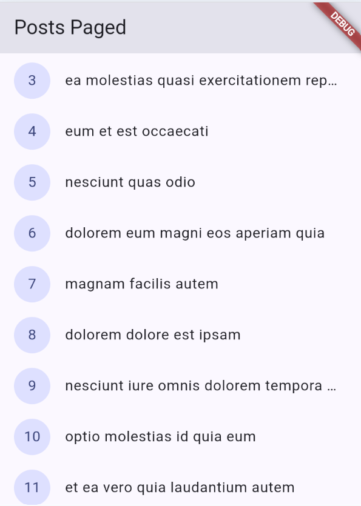
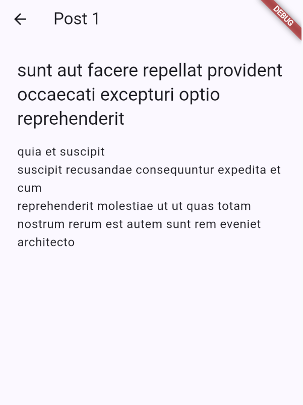
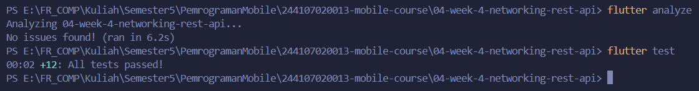
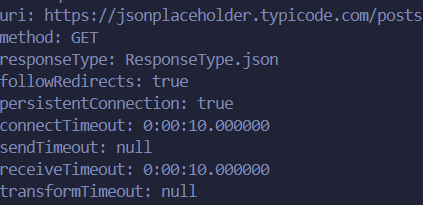
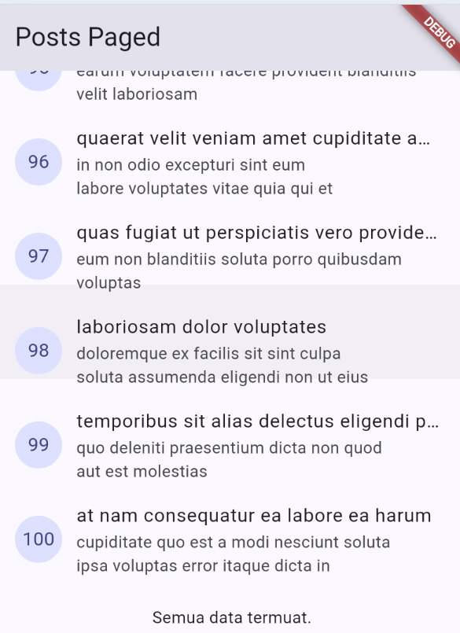

# Laporan Praktikum Mingguan: Minggu 04 - Networking & REST API Integration

## Tujuan Praktikum

- Memahami protokol HTTP, arsitektur REST API, dan format data JSON.
- Mengimplementasikan model serialisasi Dart dengan null safety defensif.
- Menerapkan Repository Pattern untuk memisahkan pengambilan data jaringan dari
  antarmuka pengguna.
- Mengonfigurasi Dio dengan base URL, timeout, dan interceptor terpusat.
- Menampilkan state loading, error, empty, dan success menggunakan Riverpod.
- Mengimplementasikan infinite scroll pagination berbasis `_page` dan `_limit`
  dengan pencegahan request ganda.
- Melakukan verifikasi melalui unit test dan widget test.

## Dependensi dan Struktur Proyek

Dependensi utama yang digunakan:

- `dio: ^5.7.0` - HTTP client dengan interceptor dan timeout terpusat.
- `flutter_riverpod: ^3.4.3` - manajemen state reaktif dan state asinkron.
- `go_router: ^18.0.1` - navigasi deklaratif.

Instalasi dependensi:

```bash
flutter pub get
```

Struktur folder utama:

```text
04-week-4-networking-rest-api/
├── lib/
│   ├── main.dart
│   ├── router.dart
│   ├── data/
│   │   ├── api_client.dart
│   │   ├── network_errors.dart
│   │   ├── paged_posts.dart
│   │   ├── providers.dart
│   │   ├── models/
│   │   │   ├── comment.dart
│   │   │   └── post.dart
│   │   └── repositories/
│   │       ├── comment_repository.dart
│   │       └── post_repository.dart
│   ├── pages/
│   │   ├── pages_post_page.dart
│   │   ├── post_detail_page.dart
│   │   └── post_list_page.dart
│   └── widgets/
│       └── post_tile.dart
├── test/
│   ├── comment_model_test.dart
│   └── post_tile_test.dart
├── screenshots/
└── README.md
```

## Implementasi Fitur

### 1. Lapisan Jaringan dan Model Data

- `createDio()` membuat satu instance Dio dengan base URL
  `https://jsonplaceholder.typicode.com`, timeout koneksi dan penerimaan data
  10 detik, serta `LogInterceptor`.
- Model `Post` dan `Comment` melakukan parsing defensif. Field numerik
  dikonversi dari `num`, sedangkan field string menggunakan nilai default
  ketika field hilang, `null`, atau memiliki tipe yang tidak sesuai.
- `PostRepository` menangani endpoint `GET /posts`,
  `GET /posts?_page={page}&_limit={limit}`, dan `GET /posts/{id}`.
- `CommentRepository` menangani endpoint
  `GET /comments?postId={id}`.

### 2. Riverpod dan Error Handling

- `PostListNotifier` mengelola daftar post dan operasi refresh.
- `PagedPostsNotifier` mengelola item pagination, halaman aktif,
  `isLoadingMore`, `hasMore`, dan error.
- `PostDetailNotifier` mengelola data post berdasarkan `id`.
- `CommentsNotifier` dan `commentsProvider` menyediakan state komentar
  berdasarkan `postId` menggunakan provider family.
- Exception dari repository diteruskan menjadi `AsyncError`, kemudian
  ditampilkan sebagai pesan ramah melalui `friendlyErrorMessage`.
- Retry otomatis provider dinonaktifkan agar error dapat diuji dan ditampilkan
  secara deterministik.

### 3. Infinite Scroll Pagination

Pagination menggunakan query `_page` dan `_limit`. Listener pada
`ScrollController` mulai memuat halaman berikutnya ketika posisi scroll
mendekati 200 px dari bagian bawah.

Guard request yang digunakan:

```dart
if (state.isLoadingMore || !state.hasMore) return;
```

Guard tersebut mencegah request ganda dan menghentikan pemuatan ketika server
tidak lagi mengembalikan data sebanyak limit.

### 4. AI Challenge: Komentar pada Post

AI Challenge berfokus pada penambahan lapisan data komentar:

- Membuat model [`Comment`](lib/data/models/comment.dart) dengan field
  `postId`, `id`, `name`, `email`, dan `body`.
- Membuat [`CommentRepository`](lib/data/repositories/comment_repository.dart)
  untuk mengambil komentar berdasarkan ID post.
- Menyediakan `commentsProvider` berbasis `AsyncNotifierProvider.family` agar
  setiap `postId` memiliki state dan cache tersendiri.
- Menambahkan serialisasi `toJson`, equality, dan pengujian parsing model.

Perbaikan manual terhadap hasil AI:

1. Parsing numerik menggunakan pemeriksaan `num` dan `toInt()` agar nilai
   integer maupun double tidak menyebabkan crash.
2. Field string menggunakan pemeriksaan tipe dan fallback string kosong untuk
   menangani field hilang, `null`, atau tipe yang tidak sesuai.
3. Error jaringan mengikuti mapper `friendlyErrorMessage` yang digunakan
   bersama oleh seluruh halaman.
4. Test mencakup JSON lengkap, field hilang, JSON kosong, ketidaksesuaian tipe,
   konversi double ke integer, equality, dan roundtrip `toJson`.

## Bukti Visual

Seluruh gambar berikut berada di folder
[`screenshots/`](screenshots/).

| Screenshot | Keterangan |
| --- | --- |
|  | Daftar post dari JSONPlaceholder. |
|  | Tampilan error dan tombol coba lagi. |
|  | Infinite scroll dengan pemuatan halaman berikutnya. |
|  | Halaman detail post pada route `/post/:id`. |
|  | Hasil pengujian otomatis. |
|  | Bukti response REST API. |
|  | Kondisi ketika seluruh data pagination telah dimuat. |


## Ringkasan Refactoring

Perubahan refactoring yang diterapkan pada proyek:

- [`PostTile`](lib/widgets/post_tile.dart) mengekstrak tampilan satu post agar
  dapat digunakan oleh halaman list dan pagination. Widget ini menerima callback
  `onTap` untuk navigasi ke halaman detail.
- [`network_errors.dart`](lib/data/network_errors.dart) menjadi satu sumber
  fungsi `friendlyErrorMessage` untuk halaman list, pagination, detail, dan
  provider lain.
- [`router.dart`](lib/router.dart) menggunakan GoRouter dengan route `/` dan
  `/post/:id`.
- [`PostDetailPage`](lib/pages/post_detail_page.dart) menampilkan `title` dan
  `body` post secara lengkap. `postDetailProvider` menggunakan post yang sudah
  dimuat di state pagination terlebih dahulu, lalu memanggil
  `PostRepository.fetchPost` jika data belum tersedia, termasuk saat route
  detail dibuka langsung.
- Akses HTTP tetap berada di repository. Widget hanya berkomunikasi dengan
  provider dan tidak membuat atau memanggil Dio secara langsung.

### Perilaku State

| Fitur | Loading | Error | Empty | Success |
| --- | --- | --- | --- | --- |
| Post list | `CircularProgressIndicator` | Pesan ramah dan tombol coba lagi | Pesan data kosong | Daftar `PostTile` |
| Pagination | Indikator di bagian bawah | Pesan ramah dan tombol coba lagi saat halaman pertama gagal | Daftar kosong dengan state awal | Item bertambah saat scroll, lalu `Semua data termuat.` |
| Detail post | `CircularProgressIndicator` | Pesan ramah dan tombol coba lagi | Tidak berlaku untuk satu post | Title dan body lengkap |

Pagination mencegah request ganda dengan guard `isLoadingMore` dan berhenti
ketika response terakhir berisi kurang dari limit. Detail post menggunakan
provider family sehingga setiap `id` mempunyai state sendiri.

### Hasil Verifikasi

- UI tidak memanggil Dio secara langsung; pemanggilan HTTP hanya ada di
  `api_client.dart` dan repository.
- Halaman list, pagination, dan detail menangani state loading, error, empty,
  dan success sesuai kebutuhannya.
- Pagination mengembalikan lebih awal saat sedang memuat atau data sudah
  habis.
- Route `/post/:id` menggunakan data pagination yang sudah tersedia dan
  memiliki fallback ke `fetchPost(id)` untuk deep link.
- `flutter analyze` berhasil tanpa issue.
- `flutter test` berhasil.

## Refleksi

1. **Mengapa UI tidak memanggil Dio secara langsung?**  
   UI bertugas merender state, sedangkan repository mengelola detail jaringan.
   Pemisahan ini mengurangi tight coupling, mencegah duplikasi konfigurasi, dan
   membuat widget lebih mudah diuji dengan fake repository.

2. **Kapan pagination client-side dan server-side digunakan?**  
   Client-side cukup untuk dataset kecil dan statis. Server-side dengan
   `_page` dan `_limit` lebih sesuai untuk dataset besar atau yang terus
   bertambah karena mengurangi data awal, bandwidth, dan penggunaan memori.

3. **Bagaimana exception menjadi `AsyncError`?**  
   Exception yang dilempar dari `build()` notifier ditangkap Riverpod dan
   tersedia melalui `AsyncValue`. Widget cukup menangani cabang `loading`,
   `error`, dan `data`; `try/catch` eksplisit tetap digunakan pada operasi
   interaktif seperti refresh manual ketika state perlu diperbarui langsung.

## Kesimpulan

Praktikum Minggu 04 berhasil menerapkan Dio, Repository Pattern, Riverpod,
error handling, model JSON null-safe, infinite scroll pagination, navigasi
detail, serta AI Challenge untuk fitur komentar. Refactoring `PostTile`,
`friendlyErrorMessage`, dan route detail membuat kode lebih modular tanpa
membebani widget dengan logika jaringan.
